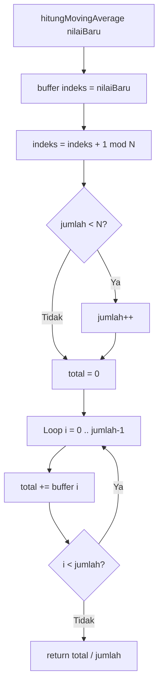
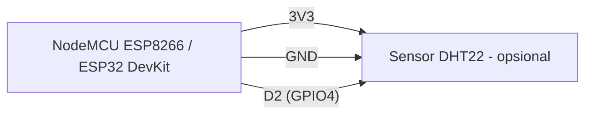
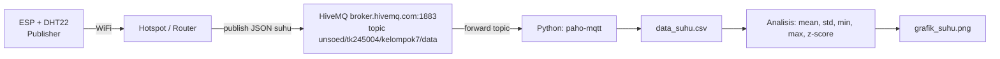
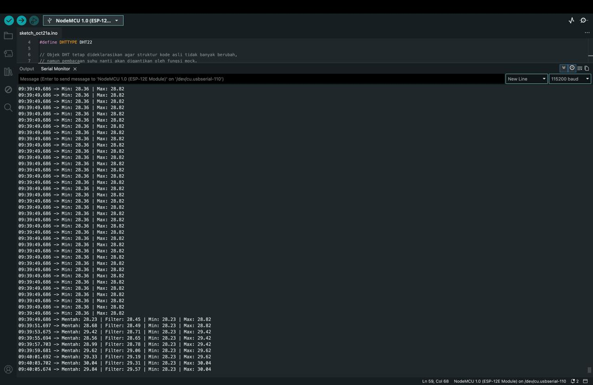
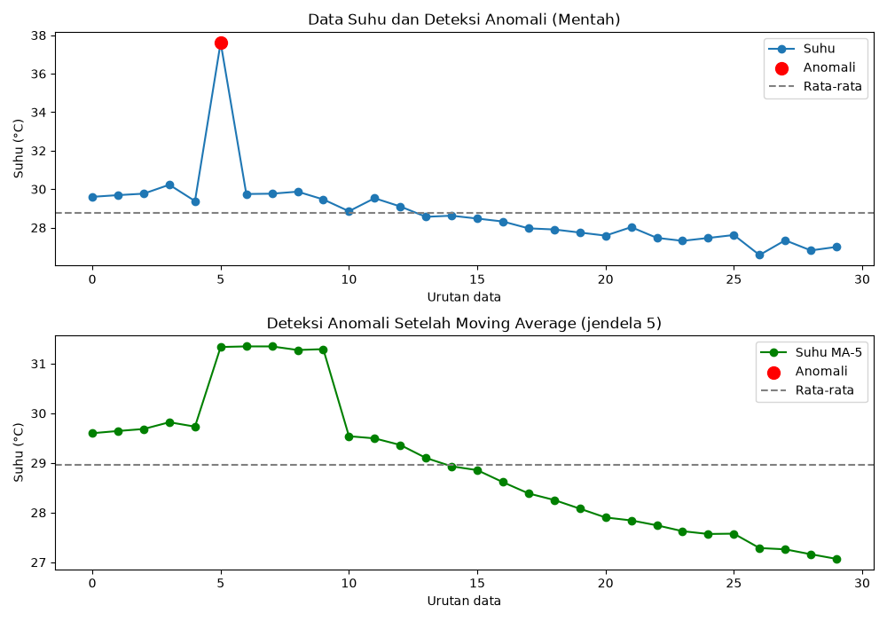

# Praktikum IoT - Modul 5: Pengolahan dan Analisis Data IoT

Dokumentasi praktikum Modul 5 IoT: pengolahan data sensor di dua sisi — _edge processing_ pada mikrokontroler (filter moving average + statistik) dan _server processing_ pada komputer (akuisisi MQTT → CSV → analisis statistik → deteksi anomali z-score → visualisasi) dengan Python.

> Catatan: Di modul tertulis ESP32 DevKit, padahal praktikum memakai ESP8266 (NodeMCU) dengan `DHT.h` dan sensor DHT22 di GPIO4 (D2), sama seperti `percobaan2.cpp` Modul 4 yang datanya dipakai ulang di Percobaan 5B. Topic data mengikuti Modul 4: `unsoed/tk245004/kelompok7/data`.
>
> Catatan Percobaan 5A: pembacaan sensor pada `percobaan1.cpp` diganti fungsi **mock** `bacaSuhuMock()` (sinyal sinus + noise + lonjakan tiap 25 sampel) agar percobaan bisa dijalankan tanpa hardware DHT22. Objek `DHT dht` tetap ada dan `dht.begin()` tetap dipanggil supaya struktur kode modul tidak berubah, tetapi nilainya tidak dipakai untuk membaca suhu.

---

## 1. Percobaan 5A: Pengolahan Data Sensor pada ESP (Moving Average dan Statistik)

### A. Penjelasan Singkat Percobaan

Menghitung rata-rata bergerak (moving average) dari 5 pembacaan terakhir untuk meredam derau, mencatat suhu minimum dan maksimum sejak program berjalan, lalu menampilkan data mentah, data terfilter, min, dan max ke Serial Monitor setiap 2 detik. Pembacaan suhu memakai fungsi **mock** `bacaSuhuMock()` — sinyal sinus 28 ± 2 °C ditambah noise kecil dan lonjakan +8 °C tiap 25 pembacaan — sebagai pengganti sensor DHT22. Sampel yang gagal dibaca (`NaN`) dibuang agar tidak merusak buffer filter.

### B. Library & Dependencies

- **DHT sensor library by Adafruit** (`DHT.h`) — objek `dht` tetap dideklarasikan dan `dht.begin()` tetap dipanggil, tetapi pembacaan suhu memakai mock
- **Adafruit Unified Sensor** (dependency pendukung library Adafruit DHT)
- **math.h** — implisit lewat `Arduino.h`, untuk `sin()`; `sqrt()` untuk modifikasi simpangan baku

### C. Penjelasan Kode & Fungsi (`percobaan1.cpp`)

```cpp
#include <DHT.h>

#define DHTPIN 4
#define DHTTYPE DHT22

// Objek DHT tetap dideklarasikan agar struktur kode asli tidak banyak berubah,
// namun pembacaan suhu nanti akan digantikan oleh fungsi mock.
DHT dht(DHTPIN, DHTTYPE);

const int N = 5;         // jumlah sampel moving average
float buffer[N];         // menyimpan N pembacaan terakhir
int indeks = 0;          // posisi penulisan berikutnya pada buffer
int jumlah = 0;          // jumlah sampel yang sudah terisi

float suhuMin = 1000.0;
float suhuMax = -1000.0;

// Mock function pengganti sensor DHT22 untuk pengujian simulasi
float bacaSuhuMock() {
    static unsigned long jumlahBaca = 0;
    jumlahBaca++;

    // Suhu dasar berubah secara bertahap menggunakan fungsi sinyal sinusoidal
    float suhuDasar = 28.0 + 2.0 * sin(jumlahBaca * 0.08);

    // Noise kecil untuk mensimulasikan fluktuasi pembacaan sensor asli
    float noise = random(-5, 6) * 0.1;

    float suhu = suhuDasar + noise;

    // Lonjakan suhu setiap 25 pembacaan untuk simulasi anomali
    if (jumlahBaca % 25 == 0) {
        suhu += 8.0;
    }

    return suhu;
}

float hitungMovingAverage(float nilaiBaru) {
    buffer[indeks] = nilaiBaru;
    indeks = (indeks + 1) % N;
    if (jumlah < N) jumlah++;

    float total = 0;
    for (int i = 0; i < jumlah; i++) {
        total += buffer[i];
    }
    return total / jumlah;
}

void setup() {
    Serial.begin(115200);
    dht.begin();
    // Menginisialisasi seed random generator agar nilai noise bervariasi setiap dijalankan
    randomSeed(analogRead(0));
}

void loop() {
    // Mengganti dht.readTemperature() dengan fungsi bacaSuhuMock()
    float suhu = bacaSuhuMock();

    if (isnan(suhu)) {
        Serial.println("Pembacaan gagal, data diabaikan");
    } else {
        float suhuFilter = hitungMovingAverage(suhu);

        if (suhu < suhuMin) suhuMin = suhu;
        if (suhu > suhuMax) suhuMax = suhu;

        Serial.print("Mentah: ");
        Serial.print(suhu);
        Serial.print(" | Filter: ");
        Serial.print(suhuFilter);
        Serial.print(" | Min: ");
        Serial.print(suhuMin);
        Serial.print(" | Max: ");
        Serial.println(suhuMax);
    }

    delay(2000);
}
```

- `#include <DHT.h>`: Pustaka sensor DHT (suhu/kelembaban); tetap dipakai karena objek `dht` masih dideklarasikan.
- `#define DHTPIN 4`: Pin data sensor di GPIO4 (D2 pada NodeMCU) — tidak lagi dibaca nilainya, hanya dipakai konstruktor.
- `#define DHTTYPE DHT22`: Tipe sensor yang dideklarasikan.
- `DHT dht(DHTPIN, DHTTYPE)`: Membuat objek sensor sesuai pin dan tipe; dipertahankan agar struktur kode modul tidak berubah.
- `const int N = 5`: Ukuran jendela filter — 5 pembacaan terakhir.
- `float buffer[N]`: Array penampung melingkar (_circular buffer_) berisi N sampel terakhir.
- `int indeks = 0`: Penunjuk slot yang akan ditulis berikutnya.
- `int jumlah = 0`: Cacah sampel valid yang sudah masuk; dipakai agar rata-rata tetap benar selama buffer belum penuh.
- `float suhuMin = 1000.0` / `suhuMax = -1000.0`: Nilai awal ekstrem sebagai pembanding pertama (bukan 0, supaya suhu negatif/positif tetap tercatat benar).
- `bacaSuhuMock()`: Pengganti `dht.readTemperature()`; mengembalikan nilai float seperti API sensor asli sehingga sisa kode tidak perlu diubah.
- `static unsigned long jumlahBaca = 0` + `jumlahBaca++`: Pencacah jumlah pembacaan; `static` membuat nilainya tetap tersimpan antar pemanggilan fungsi.
- `28.0 + 2.0 * sin(jumlahBaca * 0.08)`: Sinyal dasar yang naik-turun halus dalam rentang ±2 °C di sekitar 28 °C, meniru perubahan suhu ruangan bertahap.
- `random(-5, 6) * 0.1`: Noise acak dalam rentang −0.5 … +0.5 °C, meniru derau pembacaan sensor.
- `suhu = suhuDasar + noise`: Nilai suhu akhir = tren + derau.
- `if (jumlahBaca % 25 == 0) suhu += 8.0`: Setiap pembacaan ke-25 ditambahkan lonjakan +8 °C sebagai simulasi anomali (mirip hembusan napas/sumber panas).
- `buffer[indeks] = nilaiBaru`: Menimpa sampel tertua di slot aktif.
- `indeks = (indeks + 1) % N`: Memajukan penunjuk secara melingkar; setelah slot terakhir kembali ke 0.
- `if (jumlah < N) jumlah++`: Menambah cacah sampai maksimal N.
- `for (...) total += buffer[i]`: Menjumlahkan seluruh sampel valid di buffer.
- `return total / jumlah`: Rata-rata bergerak (moving average).
- `Serial.begin(115200)`: Inisialisasi UART 115200 baud untuk Serial Monitor.
- `dht.begin()`: Inisialisasi jalur komunikasi DHT; tetap dipanggil agar konsisten dengan program asli (tanpa sensor terpasang tidak menimbulkan error, karena tidak ada pembacaan).
- `randomSeed(analogRead(0))`: Memberi seed generator acak dari pin analog melayang agar noise berbeda setiap board di-reset.
- `isnan(suhu)`: Memvalidasi hasil baca; `true` berarti nilai tidak valid (bukan angka).
- `if (suhu < suhuMin) suhuMin = suhu`: Memperbarui nilai minimum sejak program jalan.
- `if (suhu > suhuMax) suhuMax = suhu`: Memperbarui nilai maksimum.
- `delay(2000)`: Interval sampling 2 detik; menyamai jeda minimal pembacaan DHT22.
- Catatan: nilai min/max memakai `suhu` mentah (bukan hasil filter) agar puncak asli tetap terekam — lonjakan +8 °C langsung terlihat di kolom `Max`.

### D. Penjelasan Percabangan / Conditional

1. `if (jumlahBaca % 25 == 0)`: Percabangan di mock — hanya tiap kelipatan 25 pembacaan yang diberi lonjakan anomali, sehingga data normal dan data menyimpang muncul bergantian dan perilaku filter mudah diamati.
2. `if (isnan(suhu))`: Jika pembacaan gagal, cetak `Pembacaan gagal, data diabaikan` dan sampel **tidak** dimasukkan ke buffer — filter dan min/max tidak tercemar nilai rusak. (Pada mock nilai selalu valid, cabang ini hanya jaring pengaman bila kelak kembali memakai sensor asli.)
3. `else`: Jalur normal — hitung moving average, perbarui min/max, cetak semua nilai.
4. `if (jumlah < N) jumlah++`: Percabangan pengisian buffer; selama buffer belum penuh, pembagi rata-rata adalah `jumlah`, bukan `N`, sehingga sampel awal tidak dianggap nol.
5. `if (suhu < suhuMin)` / `if (suhu > suhuMax)`: Dua percabangan pembanding untuk melacak nilai ekstrem.

---

## 2. Percobaan 5B: Akuisisi, Analisis, dan Visualisasi Data (Python)

### A. Penjelasan Singkat Percobaan

Program Python berlangganan (subscribe) ke topic data MQTT yang dipublikasikan ESP, mengumpulkan 30 sampel suhu beserta waktu penerimaannya, menyimpannya ke `data_suhu.csv`, menghitung statistik deskriptif (rata-rata, simpangan baku, min, max), mendeteksi anomali dengan z-score (|z| > 2), lalu menampilkan grafik yang menandai titik anomali dan menyimpannya sebagai `grafik_suhu.png`.

### B. Library & Dependencies

- **paho-mqtt** (`paho.mqtt.client`) — klien MQTT, versi terpasang 2.1.0
- **pandas** (`pandas`) — DataFrame & statistik, versi terpasang 3.0.6
- **matplotlib** (`matplotlib.pyplot`) — visualisasi, versi terpasang 3.11.2
- **Python** 3.14.7 (Homebrew)
- Sisi perangkat: program publish Modul 4 Percobaan 2A (`ESP8266WiFi.h`, `PubSubClient.h`, `ArduinoJson.h`, `DHT.h`)

Instalasi memakai **virtual environment** agar tidak bentrok dengan Python sistem (Homebrew Python bersifat _externally managed_, sehingga `pip install` global akan ditolak — PEP 668):

```sh
python3 -m venv .venv
source .venv/bin/activate
pip install -r requirements.txt
```

Versi terkunci tersimpan di `requirements.txt`:

```
matplotlib==3.11.2
numpy==2.5.4
paho-mqtt==2.1.0
pandas==3.0.6
pillow==13.0.0
python-dateutil==2.9.0.post0
```

### C. Penjelasan Kode & Fungsi (`percobaan2.py`)

```python
import json
import time
import paho.mqtt.client as mqtt
import pandas as pd
import matplotlib.pyplot as plt

BROKER = "broker.hivemq.com"
PORT = 1883
TOPIC = "unsoed/tk245004/kelompok7/data"  # = topicData ESP32 (Modul 4 Percobaan 2A)
JUMLAH_SAMPEL = 30  # jumlah data

data = []


def on_connect(client, userdata, flags, reason_code, properties):
    print("Terhubung ke broker, kode:", reason_code)
    client.subscribe(TOPIC)


def on_message(client, userdata, msg):
    try:
        payload = json.loads(msg.payload.decode())
        suhu = float(payload["suhu"])
    except (ValueError, KeyError, TypeError):
        print("Data tidak valid, diabaikan")
        return

    data.append({"waktu": time.strftime("%Y-%m-%d %H:%M:%S"), "suhu": suhu})

    print(f"[{len(data)}/{JUMLAH_SAMPEL}] suhu = {suhu}")

    if len(data) >= JUMLAH_SAMPEL:
        client.disconnect()


# --- Tahap 1: akuisisi data dari MQTT ---
client = mqtt.Client(mqtt.CallbackAPIVersion.VERSION2)
client.on_connect = on_connect
client.on_message = on_message
client.connect(BROKER, PORT)
client.loop_forever()

# --- Tahap 2: simpan ke CSV ---
df = pd.DataFrame(data)
df.to_csv("data_suhu.csv", index=False)
print("Data tersimpan di data_suhu.csv")

# --- Tahap 3: analisis statistik dan deteksi anomali (z-score) ---
rata2 = df["suhu"].mean()
std = df["suhu"].std()

if std == 0:
    df["zscore"] = 0.0
else:
    df["zscore"] = (df["suhu"] - rata2) / std
df["anomali"] = df["zscore"].abs() > 2

print(f"Rata-rata : {rata2:.2f}")
print(f"Std deviasi: {std:.2f}")
print(f"Minimum   : {df['suhu'].min():.2f}")
print(f"Maksimum  : {df['suhu'].max():.2f}")
print(f"Jumlah anomali: {df['anomali'].sum()}")

# --- Modifikasi soal 5.6.4 no.4: moving average jendela 5 sebelum z-score ---
df["suhu_ma"] = df["suhu"].rolling(window=5, min_periods=1).mean()
rata2_ma = df["suhu_ma"].mean()
std_ma = df["suhu_ma"].std()

if std_ma == 0:
    df["zscore_ma"] = 0.0
else:
    df["zscore_ma"] = (df["suhu_ma"] - rata2_ma) / std_ma
df["anomali_ma"] = df["zscore_ma"].abs() > 2

print(f"Jumlah anomali (mentah)       : {df['anomali'].sum()}")
print(f"Jumlah anomali (moving avg 5) : {df['anomali_ma'].sum()}")

# --- Tahap 4: visualisasi ---
fig, (ax1, ax2) = plt.subplots(2, 1, figsize=(10, 7))

ax1.plot(df.index, df["suhu"], marker="o", label="Suhu")
anom = df[df["anomali"]]
ax1.scatter(anom.index, anom["suhu"], color="red", s=100, label="Anomali", zorder=3)
ax1.axhline(rata2, color="gray", linestyle="--", label="Rata-rata")
ax1.set_xlabel("Urutan data")
ax1.set_ylabel("Suhu (°C)")
ax1.set_title("Data Suhu dan Deteksi Anomali (Mentah)")
ax1.legend()

ax2.plot(df.index, df["suhu_ma"], marker="o", color="green", label="Suhu MA-5")
anom_ma = df[df["anomali_ma"]]
ax2.scatter(anom_ma.index, anom_ma["suhu_ma"], color="red", s=100, label="Anomali", zorder=3)
ax2.axhline(rata2_ma, color="gray", linestyle="--", label="Rata-rata")
ax2.set_xlabel("Urutan data")
ax2.set_ylabel("Suhu (°C)")
ax2.set_title("Deteksi Anomali Setelah Moving Average (jendela 5)")
ax2.legend()

plt.tight_layout()
plt.savefig("grafik_suhu.png")
plt.show()
```

- `import json`: Parsing payload MQTT (`{"suhu":28.5}`) menjadi objek Python.
- `import time`: Menyediakan `strftime()` untuk stempel waktu penerimaan.
- `import paho.mqtt.client as mqtt`: Klien MQTT untuk subscribe ke broker.
- `import pandas as pd`: DataFrame untuk tabulasi data + statistik.
- `import matplotlib.pyplot as plt`: Pembuatan grafik.
- `BROKER` / `PORT`: Alamat broker publik dan port non-TLS 1883.
- `TOPIC`: Topic langganan; **wajib sama persis** dengan `topicData` di program ESP.
- `JUMLAH_SAMPEL = 30`: Target jumlah data sebelum berhenti (≈2,5 menit pada interval 5 detik).
- `data = []`: List penampung record `{waktu, suhu}`.
- `on_connect(...)`: Callback saat koneksi broker terbentuk; mencetak kode lalu `client.subscribe(TOPIC)`.
- `on_message(...)`: Callback tiap pesan masuk — inti akuisisi data.
- `json.loads(msg.payload.decode())`: Byte payload diubah ke string lalu diparse jadi dict.
- `suhu = float(payload["suhu"])`: Mengambil nilai suhu dan memaksa tipe float.
- `except (ValueError, KeyError, TypeError)`: Menangkap JSON rusak, key `suhu` tidak ada, atau tipe data aneh.
- `data.append({...})`: Menyimpan suhu + waktu lokal ke list.
- `print(f"[{len(data)}/{JUMLAH_SAMPEL}] ...")`: Progres pengumpulan di terminal.
- `client.disconnect()`: Menghentikan `loop_forever()` setelah target sampel tercapai.
- `mqtt.Client(mqtt.CallbackAPIVersion.VERSION2)`: Membuat klien dengan API callback versi 2 (paho-mqtt ≥ 2.0).
- `client.connect(BROKER, PORT)`: Membuka koneksi TCP ke broker.
- `client.loop_forever()`: Blocking loop yang memproses jaringan + callback sampai `disconnect()`.
- `pd.DataFrame(data)`: Mengubah list record menjadi tabel berkolom `waktu` dan `suhu`.
- `df.to_csv("data_suhu.csv", index=False)`: Menyimpan CSV tanpa kolom indeks.
- `df["suhu"].mean()` / `.std()`: Rata-rata dan simpangan baku (pandas memakai `ddof=1`).
- `if std == 0`: Guard bila semua nilai identik (pembagian nol).
- `(df["suhu"] - rata2) / std`: Kolom z-score untuk seluruh baris.
- `df["zscore"].abs() > 2`: Penanda boolean anomali.
- `df["suhu"].min()` / `.max()`: Nilai ekstrem.
- `df["anomali"].sum()`: Menghitung `True` sebagai jumlah anomali.
- `df["suhu"].rolling(window=5, min_periods=1).mean()`: Moving average jendela 5 pada data CSV; `min_periods=1` membuat 4 baris awal tetap terisi.
- `fig, (ax1, ax2) = plt.subplots(2, 1, ...)`: Dua panel vertikal — mentah vs setelah MA.
- `plt.plot(...)` / `plt.scatter(...)`: Garis data dan titik anomali merah.
- `plt.axhline(...)`: Garis putus-putus rata-rata sebagai acuan visual.
- `plt.savefig("grafik_suhu.png")` + `plt.show()`: Menyimpan grafik ke file lalu menampilkannya.

### D. Penjelasan Percabangan / Conditional

1. `try ... except (ValueError, KeyError, TypeError)`: Bila payload bukan JSON valid, key `suhu` hilang, atau nilainya tidak bisa dikonversi ke float → cetak `Data tidak valid, diabaikan` lalu `return` tanpa menambah sampel.
2. `if len(data) >= JUMLAH_SAMPEL`: Berhenti berlangganan setelah 30 data terkumpul; tanpa ini program menggantung selamanya.
3. `if std == 0`: Jika simpangan baku nol (data seragam), z-score diset 0 agar tidak terjadi pembagian dengan nol.
4. `df["zscore"].abs() > 2`: Percabangan klasifikasi per baris — `True` berarti anomali.
5. `if std_ma == 0`: Guard yang sama untuk jalur moving average.

---

## 3. Jawaban Pertanyaan Praktikum

### 3.1 Percobaan 5A — Moving Average dan Statistik (5.5.4)

#### 1. Gambarkan diagram alur (flowchart) proses perhitungan moving average pada fungsi `hitungMovingAverage()`!



Alur: tulis sampel baru ke slot aktif → geser indeks secara melingkar → perbarui cacah sampel → jumlahkan seluruh sampel valid → kembalikan rata-ratanya.

#### 2. Jelaskan fungsi dari operasi `(indeks + 1) % N` pada program tersebut!

Operasi modulo menjadikan `indeks` berputar melingkar dalam rentang `0..N-1`. Setelah menulis di slot terakhir (`N-1`), nilai berikutnya kembali ke `0` sehingga slot tertua otomatis tertimpa. Inilah inti _circular buffer_: memori tetap `N` elemen, tanpa `memmove`/pergeseran array, dan tanpa indeks keluar batas (mencegah _buffer overflow_).

#### 3. Apa dampaknya terhadap data hasil filter apabila nilai N diperbesar menjadi 20 atau diperkecil menjadi 2?

- **N = 20:** Kurva jauh lebih halus karena derau acak saling meniadakan, tetapi respons lambat — perubahan nyata (misal sensor dihembus napas) baru terlihat penuh setelah ~20 sampel (≈40 detik pada sampling 2 detik). Cocok untuk data lambat, buruk untuk kendali aktuator.
- **N = 2:** Hampir tidak ada penghalusan; filter nyaris mengikuti data mentah. Respons cepat dan lag kecil, tetapi derau masih lolos sehingga aktuator berisiko _chattering_.
- Kompromi: pilih N sesuai dinamika besaran yang diukur, bukan sekadar "sehalus mungkin".

#### 4. Modifikasi program agar menghitung simpangan baku dari data pada buffer

Modifikasi **tidak** disertakan di `percobaan1.cpp` (file tetap versi mock tanpa kolom Std); kode tambahan berikut ditampilkan di README sebagai jawaban soal:

```cpp
#include <math.h>

float hitungSimpanganBaku() {
  if (jumlah < 2) return 0.0;   // butuh minimal 2 sampel

  float rata = 0;
  for (int i = 0; i < jumlah; i++) rata += buffer[i];
  rata /= jumlah;

  float varian = 0;
  for (int i = 0; i < jumlah; i++) {
    varian += (buffer[i] - rata) * (buffer[i] - rata);
  }
  varian /= (jumlah - 1);

  return sqrt(varian);
}

// di loop(), setelah hitungMovingAverage():
Serial.print(" | Std: ");
Serial.print(hitungSimpanganBaku());
```

#### Penjelasan Setiap Baris Kode Modifikasi:

- `#include <math.h>`: Menyediakan fungsi `sqrt()` untuk akar kuadrat (pada Arduino, `sin()`/`sqrt()` sudah tersedia lewat `Arduino.h`, include ini eksplisit saja).
- `float hitungSimpanganBaku()`: Fungsi baru tanpa parameter — membaca langsung buffer global yang sudah berisi N sampel terakhir.
- `if (jumlah < 2) return 0.0`: Guard; dengan 1 sampel, `jumlah - 1 = 0` akan menyebabkan pembagian nol.
- `for (...) rata += buffer[i]`: Menghitung rata-rata buffer (mean lokal, bukan mean seluruh riwayat).
- `rata /= jumlah`: Menormalkan total menjadi rata-rata.
- `varian += (buffer[i] - rata) * ...`: Menjumlahkan kuadrat deviasi tiap sampel terhadap rata-rata.
- `varian /= (jumlah - 1)`: Varian **sampel** (Bessel's correction, `n-1`), konsisten dengan `pandas.std()`. Pakai `jumlah` bila menginginkan varian populasi.
- `return sqrt(varian)`: Akar varian = simpangan baku, satuan sama dengan suhu (°C).
- `Serial.print(" | Std: ")` + `Serial.print(hitungSimpanganBaku())`: Menambahkan kolom simpangan baku pada keluaran Serial Monitor tanpa mengubah format kolom lain.

Catatan: simpangan baku dihitung dari buffer yang **sudah** diisi sampel baru, jadi nilainya mencerminkan sebaran jendela filter saat itu (0 pada sampel pertama, lalu naik saat variasi muncul). Pada data mock, nilai Std akan melonjak tepat setelah sampel ke-25 karena lonjakan +8 °C masuk jendela, lalu turun lagi setelah lonjakan keluar dari 5 sampel terakhir.

### 3.2 Percobaan 5B — Akuisisi, Analisis, Visualisasi (5.6.4)

#### 1. Jelaskan fungsi dari blok `try-except` pada fungsi `on_message()` dan apa yang terjadi apabila blok tersebut dihilangkan!

`try-except` menjaga proses parsing payload agar tidak mematikan program saat data cacat: JSON tidak valid (`json.JSONDecodeError` turunan `ValueError`), key `suhu` tidak ada (`KeyError`), atau nilai tidak bisa di-`float()` (`TypeError`). Bila terjadi, program mencetak `Data tidak valid, diabaikan` lalu `return` — sampel buruk dibuang, pengumpulan lanjut.

Tanpa `try-except`, exception naik ke `loop_forever()` dan menghentikan thread jaringan paho: program **crash/berhenti** (traceback di terminal), tidak ada CSV, tidak ada statistik, tidak ada grafik. Satu pesan rusak dari topic publik sudah cukup menggagalkan seluruh percobaan — terutama penting karena `broker.hivemq.com` dipakai bersama banyak pengguna.

#### 2. Jelaskan arti nilai z-score dan mengapa batas |z| > 2 digunakan sebagai penentu anomali!

Z-score menyatakan jarak sebuah nilai dari rata-rata dalam satuan simpangan baku: `z = (x - rata-rata) / std`. `z = 0` berarti tepat di rata-rata, `z = +1,5` berarti 1,5 simpangan baku di atas rata-rata. Nilainya tak bersatuan sehingga bisa dibandingkan antar besaran berbeda.

Batas `|z| > 2` dipakai karena pada distribusi normal ≈95% data berada dalam ±2 simpangan baku; hanya ≈5% di luar itu. Jadi ambang ini menandai nilai yang "jarang" secara statistik dengan tingkat kesalahan (false positive) yang wajar untuk data sensor. Ambang lebih kecil (1,5) menangkap lebih banyak anomali tapi banyak alarm palsu; lebih besar (3) hanya menangkap penyimpangan ekstrem. Nilai 2 adalah kompromi praktis dan mudah dijelaskan, bukan hukum mutlak.

#### 3. Apa kelemahan metode z-score apabila data memiliki tren naik atau turun yang tajam?

- **Rata-rata & std dihitung global** atas seluruh data, sehingga tren menggeser keduanya. Std ikut membengkak karena tren, akibatnya anomali nyata justru "tertelan" (z mengecil) dan tidak terdeteksi.
- **Deteksi tidak lokal**: titik di awal tren bisa tampak anomali hanya karena berada jauh dari rata-rata global, padahal nilainya normal untuk saat itu.
- **Asumsi distribusi normal & stasioner** dilanggar; data sensor berseri waktu biasanya berkorelasi antar waktu.
- **Titik transisi** (perubahan level mendadak yang sah, misal pintu kulkas dibuka) dianggap anomali walau itu kejadian nyata.
- Perbaikan: moving average sebelum z-score (modifikasi soal 4), z-score bergulir (_rolling mean/std_), differencing, atau metode berbasis model seperti EWMA/IQR.

#### 4. Modifikasi program agar memakai moving average (jendela 5) pada data CSV sebelum dihitung z-score, lalu bandingkan jumlah anomali

Modifikasi sudah diterapkan pada `percobaan2.py`:

```python
# --- Modifikasi soal 5.6.4 no.4: moving average jendela 5 sebelum z-score ---
df["suhu_ma"] = df["suhu"].rolling(window=5, min_periods=1).mean()
rata2_ma = df["suhu_ma"].mean()
std_ma = df["suhu_ma"].std()

if std_ma == 0:
    df["zscore_ma"] = 0.0
else:
    df["zscore_ma"] = (df["suhu_ma"] - rata2_ma) / std_ma
df["anomali_ma"] = df["zscore_ma"].abs() > 2

print(f"Jumlah anomali (mentah)       : {df['anomali'].sum()}")
print(f"Jumlah anomali (moving avg 5) : {df['anomali_ma'].sum()}")
```

#### Penjelasan Setiap Baris Kode Modifikasi:

- `df["suhu"].rolling(window=5, min_periods=1).mean()`: Membuat jendela bergerak 5 baris dan mengambil rata-ratanya; `min_periods=1` mencegah `NaN` pada 4 baris pertama (rata-rata dihitung dari sampel yang tersedia).
- `df["suhu_ma"] = ...`: Menyimpan hasil filter sebagai kolom baru agar data mentah tetap utuh untuk pembanding.
- `rata2_ma = df["suhu_ma"].mean()`: Rata-rata data **terfilter** — dasar z-score baru.
- `std_ma = df["suhu_ma"].std()`: Simpangan baku data terfilter; nilainya lebih kecil dari `std` mentah karena derau sudah diredam.
- `if std_ma == 0`: Guard pembagian nol bila data benar-benar konstan.
- `df["zscore_ma"] = (df["suhu_ma"] - rata2_ma) / std_ma`: Z-score dihitung pada data halus, bukan data mentah.
- `df["anomali_ma"] = df["zscore_ma"].abs() > 2`: Klasifikasi anomali dengan ambang yang sama agar perbandingan adil (_apple to apple_).
- Dua `print` terakhir: Menampilkan kedua jumlah anomali berdampingan sebagai bahan analisis.

**Hasil perbandingan (data riil 30 sampel, 10:14:45–10:17:10 WIB):**

| Metrik                     | Data mentah      | Setelah MA-5  |
| -------------------------- | ---------------- | ------------- |
| Jumlah anomali (\|z\| > 2) | **1** (indeks 5) | **0**         |
| Rata-rata (°C)             | 28,78            | 28,78         |
| Simpangan baku (°C)        | 1,975            | 1,378         |
| Nilai z maksimum           | **4,476**        | 1,734         |
| Minimum / Maksimum (°C)    | 26,57 / 37,62    | 27,07 / 31,35 |

Anomali tunggal terdeteksi pada sampel ke-6 (indeks 5) sebesar **37,62 °C**, z = **4,476** — jauh melewati ambang 2. Setelah moving average jendela 5, titik tersebut menjadi **31,34 °C** dengan z = **1,725**, sehingga **tidak lagi terklasifikasi sebagai anomali**. Amplitudo lonjakan turun dari 8,84 °C di atas rata-rata menjadi 2,56 °C (teredam ±3,5×).

Dua konsekuensi yang teramati:

1. **Filter mengurangi alarm palsu.** Lonjakan sesaat (sentuhan tangan/hembusan napas) yang berdurasi satu sampel diredam sehingga tidak memicu klasifikasi anomali — berguna bila aktuator tidak boleh bereaksi terhadap noise sensor.
2. **Filter menggeser dan menyebarkan anomali (_smearing_).** Lonjakan satu titik pada indeks 5 menyebar menjadi plateau MA-5 pada indeks 5–9 (nilai tertahan di ≈31,3 °C selama 5 sampel). Anomali asli berdurasi 5 detik menjadi jejak 25 detik, dan posisi puncaknya bergeser. Selain itu simpangan baku ikut mengecil (1,975 → 1,378), sehingga ambang |z| > 2 pada data terfilter menjadi **relatif lebih longgar** dan berpotensi meloloskan penyimpangan yang sebenarnya berarti.

Kesimpulan: MA sebelum z-score cocok untuk **mengurangi false positive** dan menampilkan tren, tetapi **mengorbankan sensitivitas serta resolusi temporal** deteksi. Untuk sistem yang menuntut respons cepat terhadap gangguan nyata, jalur data mentah tetap harus dipertahankan — karena itu grafik dibuat dua panel (mentah vs MA-5) agar keduanya dapat dibandingkan berdampingan.

### 3.3 Pertanyaan Analisis (5.7)

#### 1. Uraikan hasil tugas pada praktikum yang telah dilakukan pada setiap percobaan!

- **Percobaan 5A (edge processing):** Serial Monitor (115200 baud) menampilkan baris `Mentah: ... | Filter: ... | Min: ... | Max: ...` tiap 2 detik. Pada sampel-sampel awal, nilai `Filter` masih sama dengan `Mentah` (buffer belum penuh); setelah 5 sampel, `Filter` bergerak lebih halus dan tidak lagi melonjak mengikuti noise ±0.5 °C. Data mock mengikuti pola sinus 28 ± 2 °C, sehingga `Mentah` naik-turun bertahap; setiap pembacaan ke-25 muncul lonjakan +8 °C (≈38 °C) yang membuat `Max` langsung ter-update sedangkan `Filter` hanya naik sebagian (≈ tertahan di kisaran 30 °C karena dirata-rata 5 sampel) — sesuai spesifikasi bahwa filter memperlambat respons. `Min`/`Max` hanya berubah saat ada nilai yang benar-benar melampaui rekor sebelumnya. Cabang `isnan` tidak pernah aktif karena mock selalu mengembalikan nilai valid.
- **Percobaan 5B (server processing):** Python mencetak `Terhubung ke broker, kode: Success` lalu progres `[n/30] suhu = ...` setiap ±5 detik sampai 30 sampel terkumpul dalam rentang 10:14:45–10:17:10 WIB. `data_suhu.csv` berisi 30 baris kolom `waktu` dan `suhu` dengan suhu berkisar **26,57–37,62 °C**. Statistik yang tercetak: rata-rata **28,78 °C**, simpangan baku **1,98 °C**, minimum **26,57 °C**, maksimum **37,62 °C**, jumlah anomali **1**. Data menunjukkan tren penurunan bertahap dari ≈29,8 °C di awal menuju ≈27,0 °C di akhir (turun ≈2,8 °C sepanjang 2,5 menit), dengan satu lonjakan tajam 37,62 °C pada sampel ke-6. Grafik dua panel (`grafik_suhu.png`) menandai titik anomali merah pada panel mentah dan garis rata-rata putus-putus; pada panel MA-5 tidak ada titik anomali. Setelah modifikasi MA-5: anomali mentah **1** vs anomali terfilter **0**, sesuai spesifikasi seluruh poin.

#### 2. Bandingkan pengolahan data di sisi perangkat (Percobaan 5A) dengan sisi komputer (Percobaan 5B) dari segi kecepatan, kompleksitas analisis, dan kebutuhan sumber daya!

| Aspek            | Edge (5A, ESP)                                                                                              | Server (5B, Python)                                                                                              |
| ---------------- | ----------------------------------------------------------------------------------------------------------- | ---------------------------------------------------------------------------------------------------------------- |
| **Kecepatan**    | Respons per sampel langsung (orde mikrodetik–milidetik); keputusan aktuator bisa seketika                   | Bergantung latensi jaringan + periode publish; analisis baru jalan setelah 30 sampel terkumpul (±2,5 menit)      |
| **Kompleksitas** | Terbatas: rata-rata bergerak, min/max, simpangan baku; tanpa pandas/plot                                    | Tinggi: DataFrame, rolling window, z-score, agregasi multi-kolom, visualisasi, mudah ditambah model statistik/ML |
| **Sumber daya**  | RAM/Flash kecil (ratusan byte buffer), CPU lemah, tanpa penyimpanan historis — data lama hilang saat reboot | RAM/CPU/disk berlebih, bisa menyimpan CSV berhari-hari, menjalankan banyak analisis paralel                      |
| **Ketersediaan** | Tetap jalan walau internet mati                                                                             | Butuh koneksi ke broker/cloud                                                                                    |
| **Keterbatasan** | Tidak cocok untuk analisis kompleks atau histori panjang                                                    | Tidak bisa menggantikan respons cepat aktuator (latency + ketergantungan jaringan)                               |

Kesimpulan: keduanya komplementer — edge untuk respons cepat & pengurangan volume data, server untuk analitik mendalam & histori.

#### 3. Bagaimana pengaruh pemilihan ukuran jendela moving average terhadap kualitas data dan kecepatan respons sistem kendali apabila data tersebut digunakan untuk mengendalikan aktuator?

Jendela besar (N tinggi) menghasilkan data halus dan stabil, tetapi menambah **lag** ≈ (N−1)/2 × periode sampling. Untuk aktuator, lag berarti keterlambatan aksi: pada N=20 dengan sampling 2 detik, respons bisa tertunda puluhan detik — cukup untuk membuat ruangan kepanasan atau tangki meluap sebelum relay bereaksi. Jendela kecil (N=2–3) responsif dan lag minimal, tetapi derau masih lolos sehingga aktuator berpotensi _chattering_ (nyala-mati cepat) yang memperpendek umur relay dan membuang energi.

Praktiknya: pilih N berdasarkan konstanta waktu proses fisik yang dikendalikan (misal N kecil untuk kendali cepat, N besar untuk monitoring tren), atau gunakan histerisis/deadband agar chattering tidak terjadi, serta pertimbangkan filter yang lag-nya lebih kecil (EMA) bila responsivitas kritis.

#### 4. Bagaimana hasil analisis dan deteksi anomali dapat dimanfaatkan untuk meningkatkan keandalan sistem IoT, misalnya pada sistem smart farming atau smart home?

- **Deteksi kegagalan sensor vs kejadian nyata.** Anomali tajam berulang pada satu sensor bisa menandakan sensor rusak/kabel longgar → sistem memberi tahu teknisi, bukan bereaksi buta. Anomali yang konsisten di beberapa sensor sekaligus justru kejadian nyata (misal suhu greenhouse benar-benar naik).
- **Validasi data sebelum aktuasi.** Data dengan |z| > 2 dapat ditahan/ditandai agar tidak langsung memicu pompa atau pemanas — mencegah aktuasi salah akibat satu pembacaan rusak.
- **Alarm dini.** Pada smart home, lonjakan suhu abnormal = potensi kebakaran; pada smart farming, kelembaban tanah menyimpang jauh dari pola = kemungkinan kebocoran irigasi atau sensor tertimbun.
- **Perawatan prediktif.** Tren z-score yang bergeser perlahan (drift) mendeteksi kalibrasi sensor yang mulai melenceng sebelum datanya benar-benar tak terpakai.
- **Prioritas data.** Anomali bisa dikirim segera (QoS/notifikasi), sementara data normal dicatat periodik — menghemat bandwidth.
- **Umpan balik perbaikan.** Jumlah dan pola anomali menjadi dasar penyesuaian ambang, penempatan sensor, atau penambahan redundansi sensor di titik kritis.

---

## 4. Skematik & Diagram Rangkaian

### Rangkaian Percobaan 5A (DHT22 di ESP — opsional, kode memakai mock)



> Wiring ini hanya relevan bila `bacaSuhuMock()` diganti kembali `dht.readTemperature()`. Pada kode yang dijalankan, nilai suhu dibangkitkan perangkat lunak sehingga ESP cukup dihubungkan ke USB — tanpa sensor tetap berjalan.

### Topologi Percobaan 5B (MQTT → Python)



### Alur Pengolahan Data


### Hasil Percobaan

#### Output Percobaan 5A (Moving Average + Statistik)

Serial Monitor menampilkan `Mentah: ... | Filter: ... | Min: ... | Max: ...` tiap 2 detik, dengan lonjakan +8 °C tiap pembacaan ke-25.



#### Output Percobaan 5B (Akuisisi + Analisis + Visualisasi)

Terminal menampilkan progres `[n/30] suhu = ...`, statistik, dan jumlah anomali; grafik dua panel (mentah vs MA-5) tersimpan sebagai `grafik_suhu.png`.

```
Terhubung ke broker, kode: Success
[1/30] suhu = 29.59915
[2/30] suhu = 29.68809
[3/30] suhu = 29.76431
[4/30] suhu = 30.22796
[5/30] suhu = 29.37929
[6/30] suhu = 37.61859
...
[29/30] suhu = 26.814
[30/30] suhu = 26.99571
Data tersimpan di data_suhu.csv
Rata-rata : 28.78
Std deviasi: 1.98
Minimum   : 26.57
Maksimum  : 37.62
Jumlah anomali: 1
Jumlah anomali (mentah)       : 1
Jumlah anomali (moving avg 5) : 0
```



#### Tabel Data Hasil Akuisisi (30 sampel)

|     # | Waktu        | Suhu (°C) |   z-score | MA-5 (°C) |  z (MA-5) |
| ----: | ------------ | --------: | --------: | --------: | --------: |
|     1 | 10:14:45     |     29,60 |     0,415 |     29,60 |     0,465 |
|     2 | 10:14:50     |     29,69 |     0,460 |     29,64 |     0,498 |
|     3 | 10:14:55     |     29,76 |     0,499 |     29,68 |     0,527 |
|     4 | 10:15:00     |     30,23 |     0,734 |     29,82 |     0,626 |
|     5 | 10:15:06     |     29,38 |     0,304 |     29,73 |     0,562 |
| **6** | **10:15:10** | **37,62** | **4,476** | **31,34** | **1,725** |
|     7 | 10:15:15     |     29,75 |     0,490 |     31,35 |     1,734 |
|     8 | 10:15:20     |     29,76 |     0,498 |     31,35 |     1,734 |
|     9 | 10:15:25     |     29,87 |     0,552 |     31,28 |     1,681 |
|    10 | 10:15:30     |     29,46 |     0,347 |     31,29 |     1,694 |
|    11 | 10:15:35     |     28,85 |     0,037 |     29,54 |     0,422 |
|    12 | 10:15:40     |     29,53 |     0,380 |     29,50 |     0,390 |
|    13 | 10:15:45     |     29,10 |     0,162 |     29,36 |     0,294 |
|    14 | 10:15:52     |     28,56 |    −0,110 |     29,10 |     0,104 |
|    15 | 10:15:55     |     28,62 |    −0,081 |     28,93 |    −0,019 |
|    16 | 10:16:00     |     28,47 |    −0,156 |     28,86 |    −0,074 |
|    17 | 10:16:05     |     28,32 |    −0,234 |     28,61 |    −0,250 |
|    18 | 10:16:10     |     27,96 |    −0,414 |     28,39 |    −0,415 |
|    19 | 10:16:15     |     27,90 |    −0,443 |     28,25 |    −0,510 |
|    20 | 10:16:20     |     27,74 |    −0,524 |     28,08 |    −0,637 |
|    21 | 10:16:25     |     27,58 |    −0,605 |     27,90 |    −0,766 |
|    22 | 10:16:30     |     28,02 |    −0,382 |     27,84 |    −0,809 |
|    23 | 10:16:35     |     27,47 |    −0,664 |     27,74 |    −0,880 |
|    24 | 10:16:40     |     27,31 |    −0,743 |     27,63 |    −0,966 |
|    25 | 10:16:45     |     27,46 |    −0,667 |     27,57 |    −1,007 |
|    26 | 10:16:50     |     27,61 |    −0,589 |     27,58 |    −1,002 |
|    27 | 10:16:55     |     26,57 |    −1,116 |     27,29 |    −1,213 |
|    28 | 10:17:00     |     27,34 |    −0,728 |     27,26 |    −1,231 |
|    29 | 10:17:05     |     26,81 |    −0,995 |     27,16 |    −1,303 |
|    30 | 10:17:10     |     27,00 |    −0,903 |     27,07 |    −1,371 |

Catatan: |z| > 2 hanya terlampaui oleh sampel ke-6 pada data mentah (z = 4,476). Pada data MA-5, nilai z maksimum hanya 1,734 sehingga **tidak ada** sampel yang terdeteksi sebagai anomali.

#### Berkas Hasil

- `data_suhu.csv` — 30 baris data suhu (kolom `waktu`, `suhu`) hasil akuisisi riil 10:14:45–10:17:10 WIB.
- `grafik_suhu.png` — grafik dua panel: data mentah + penanda anomali, dan data MA-5 tanpa anomali.
- `percobaan2.py` — program akuisisi, analisis, dan visualisasi (termasuk modifikasi MA-5).
- `requirements.txt` — daftar dependensi terkunci untuk reproduksi venv.

#### Cara Menjalankan Ulang

```sh
python3 -m venv .venv
source .venv/bin/activate
pip install -r requirements.txt
python percobaan2.py
```

Pastikan `TOPIC` pada `percobaan2.py` sama persis dengan `topicData` yang dipakai ESP, lalu nyalakan ESP sebelum menjalankan program.
